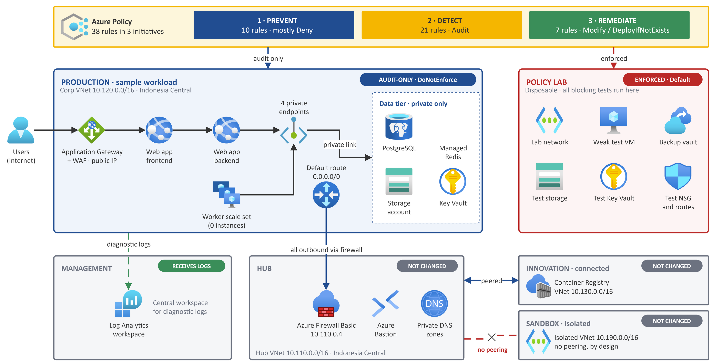
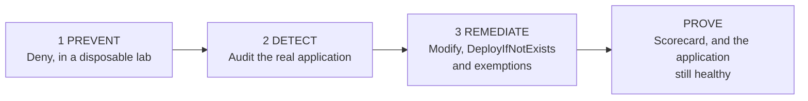

# Azure Policy Guardrails for Indonesian Financial Institutions

**Prevent · Detect · Remediate** - nine control families, 38 Azure Policy rules and a tested, step-by-step demo that turns the outcomes financial-sector guidance commonly describes - where data lives, who can reach it, how it is encrypted, logged, backed up and owned - into Azure Policies you can *demonstrate* on a real landing zone.

> **Status.** Tested once, end to end, in Azure Cloud Shell in October 2026: the command path of Parts 1 to 4 and clean-up Level 1. The Portal boxes, Test 10 and clean-up Levels 2 to 4 have **not** been run yet; [Appendix H](docs/runbook/appendix-h-dry-run-record.md) records exactly what was and was not observed. Technical guidance, **not legal advice**: a green Azure Policy dashboard is evidence for the technical part of a control, not proof of compliance.

*Editable source: [`diagrams/azure-policy-demo-architecture.drawio`](diagrams/azure-policy-demo-architecture.drawio) (draw.io, Azure icons).*

---

## Why this exists

| The problem | What this repository gives you |
|---|---|
| Regulation and supervisory guidance tend to describe **outcomes** (data location, access control, encryption, monitoring, recoverability, accountability), not Azure settings | **Nine control families** that translate those outcomes into configuration Azure Policy can inspect |
| Most policy demos stop at "assign a built-in initiative" | The **whole loop** on a real workload: prevent in a lab, detect in production, remediate with explicit tasks, record exemptions, prove with a before-and-after scorecard |
| Switching on `Deny` in production breaks things at the worst moment | An **audit-first method**: `DoNotEnforce`, an impact preview, remediation only by a task you start, and enforcement only in a disposable lab |
| Policy JSON, managed identities, roles and exemptions are hard for newcomers | **Five custom definitions, three initiatives** with the exact JSON, and a runbook written for beginners that says *where* to type or click for every step |

## What you will see

| Chapter | Effect | What happens | Measured in the dry run |
|---|---|---|---|
| **1 PREVENT** | `Deny` | Nine unsafe actions in a disposable lab are refused with a plain-language message. The same rules then run as a what-if on production, without blocking anything | **9 of 9 refused** (two of them only on the second run, hence the extra 10-minute wait in step 2.3). Production what-if: **27 findings** (26 missing `Owner` tags + 1 Key Vault without purge protection) |
| **2 DETECT** | `Audit`, `AuditIfNotExists` | 21 audit rules read the real application and explain every gap | **11 production findings** (lab VM: 6), each traced to a setting you can open in the Portal |
| **3 REMEDIATE** | `Modify`, `DeployIfNotExists`, exemptions | Tags are copied from the resource group, diagnostic settings are deployed, a VM is backed up by tag, four exceptions are recorded with a reason and an expiry | **26 of 26** resources tagged; 4 production diagnostic settings; 1 of 1 VM protected; 4 exemptions (2 *Mitigated*, 2 *Waiver*) |

The application keeps running throughout. After every chapter the dry run measured **403** on a direct call and backend health **Healthy**. Whether you can also see the **200** through the gateway depends on where you run the test (in the dry run, from Azure Cloud Shell, that first line showed *no answer*). `Test-SampleApp` prints all three lines so that you always have a before-and-after check.

## The nine control families

| | Family | Examples (in the initiatives, or assigned separately) |
|---|---|---|
| F1 | Approved deployment **locations** | Allowed locations; resource groups only in approved regions |
| F2 | No unintended **public exposure** | No public IP on a NIC; no Internet-open SSH/RDP; public network access disabled on web apps, Storage, Key Vault, PostgreSQL, Redis |
| F3 | Protect data **in transit** | HTTPS-only storage and web apps; minimum TLS; HTTPS listener on the Application Gateway |
| F4 | Protect **stored data and keys** | Key Vault purge protection and RBAC; infrastructure encryption; encryption at host |
| F5 | Central **monitoring** | Diagnostic settings sent to one Log Analytics workspace (audited, then deployed) |
| F6 | **Backup** and recovery | VM backup by tag; geo-redundant database backup reported |
| F7 | Secure **compute** baseline | Trusted Launch; vulnerability assessment |
| F8 | Network **segmentation** | Default route through the hub firewall; NSGs on subnets; no peering into the isolated sandbox |
| F9 | **Ownership** and accountability | `CostCenter` and `Owner` tags required, then inherited from the resource group |

The 38 rules are split 10 / 21 / 7 across Prevent, Detect and Remediate. See [`docs/architecture.md`](docs/architecture.md) and [Appendix B](docs/runbook/appendix-b-policy-catalogue.md).

## What is in the box

| Path | What it holds |
|---|---|
| [`docs/runbook/`](docs/runbook/README.md) | **The runbook** - Parts 0 to 6 and Appendices A to H, written for beginners, with "where to do this", "what you should see" and "what to say" for every step |
| [`docs/architecture.md`](docs/architecture.md) | The environment, where each policy is assigned, effects, identities and roles |
| [`docs/regulatory-themes.md`](docs/regulatory-themes.md) | The regulatory outcomes behind the nine families, and what Azure Policy cannot show |
| [`policies/`](policies/README.md) | The JSON: 5 custom definitions, 3 initiatives (rules, parameters, groups, friendly messages) and a catalogue of all 38 rules |
| [`scripts/`](scripts/README.md) | The runbook's PowerShell, generated from the pages - to run **block by block** |
| [`diagrams/`](diagrams/) | Architecture and policy-scope diagrams (draw.io + PNG) and the three runbook figures |
| [`tools/`](tools/) | `validate_repo.py` (also run by CI) and `extract_scripts.py` |

## Quick start

**Prerequisites:** an Azure subscription where you are **Owner**; Azure CLI 2.88+ (tested with 2.91); PowerShell 7 or Azure Cloud Shell (used for the dry run), or Windows PowerShell 5.1; and the [**reference landing zone**](https://github.com/stefpin/azure-landing-zone) deployed (or one with the same names). Plan about **3 hours** the first time, most of it waiting for Azure Policy.

1. Deploy the [reference landing zone](https://github.com/stefpin/azure-landing-zone).
2. Clone this repository: `git clone https://github.com/stefpin/azure-policy-guardrails-indonesia-financial-institutions.git`
3. Open [`docs/runbook/00-before-you-start.md`](docs/runbook/00-before-you-start.md), then follow Parts 1 to 5 in order. The only values you must set are `$SUB` (your subscription ID) and `$OWNER` (your alias) in step 1.2.
4. Prefer a file to paste from? See [`scripts/README.md`](scripts/README.md).

## Safety

- **Nothing is enforced in production.** Every production assignment uses `DoNotEnforce`; enforcement is switched on only in the disposable lab (`rg-alz-policy-lab`).
- **Everything new is prefixed** `alz-pd-` ("policy demo"), and [Appendix A](docs/runbook/appendix-a-everything-this-runbook-creates.md) lists every object with the command that removes it.
- **The only changes to production resources** are the two remediations you choose in Chapter 3 (`Owner` tags and diagnostic settings) and, if missing, an `Owner` tag on the resource groups. Chapter 3 also adds role assignments for the policy identities, four exemptions and the `alz-pd-*` assignments. All of it is reversible (Part 5, Levels 3 and 4).
- **Four clean-up levels** in Part 5; Level 1 puts every assignment back to `DoNotEnforce` and is safe to run at any time.
- The two resource-group rules are assigned at subscription scope for a few minutes, match only `rg-alz-*` names, and are switched off straight afterwards.

## Honest limitations

- **One dry run, one environment.** The counts (27, 11, 26, ...) were measured once and can differ by a few on another run or another landing zone. The pattern matters, and step 1.3 prints the settings your results depend on.
- **Your landing zone may differ from the one the numbers were measured on.** Differences (for example whether the web apps enforce HTTPS-only, or which subnets have an NSG) change which findings you see; step 1.3 tells you.
- **Not tested yet:** the Portal (Option B) boxes, Test 10 (the Portal denial) and clean-up Levels 2 to 4. The changes made after the dry run to generalise the runbook are also not tested end to end ([Appendix H](docs/runbook/appendix-h-dry-run-record.md)).
- **PowerShell 7 in Azure Cloud Shell was used for the dry run.** Every script parses in Windows PowerShell 5.1, but it - and Windows cultures other than English - was not run end to end.
- **Policy is a technical guardrail.** It does not cover contracts, regulator approvals, identity governance, penetration testing, incident handling or disaster-recovery exercises.
- **Azure changes.** Built-in definitions are versioned (see [`policies/catalog.json`](policies/catalog.json)), Portal menus move, and service facts quoted in the runbook (for example regional availability) were true during the dry run.
- **Known gaps in built-in coverage:** the Redis diagnostics rule returned no result for the Redis database, and the Application Gateway's own diagnostic setting blocks the policy's ([trap in step 4.4](docs/runbook/04-chapter-3-remediate-and-prove.md)).

## Regulatory context

The families follow outcomes that financial-sector guidance commonly describes; the repository cites no regulation on purpose, because the applicable text and its current version are for your compliance team to confirm. See [`docs/regulatory-themes.md`](docs/regulatory-themes.md). Supervisors: [OJK](https://www.ojk.go.id) and [Bank Indonesia](https://www.bi.go.id).

## Contributing and feedback

Issues and pull requests are welcome - especially dry run results from other landing zones (add them to [Appendix H](docs/runbook/appendix-h-dry-run-record.md)). Run `python tools/validate_repo.py` before you open a pull request.

## License and disclaimer

[MIT](LICENSE). This is an independent teaching resource, **not an official Microsoft publication** and not endorsed by any regulator or company named in it; see [`NOTICE.md`](NOTICE.md). Privacy and provenance notes: [`SANITIZATION.md`](SANITIZATION.md).
