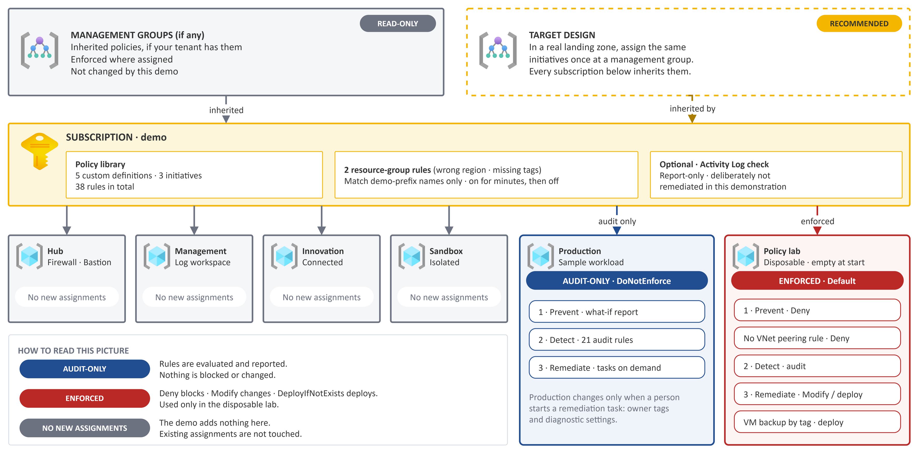
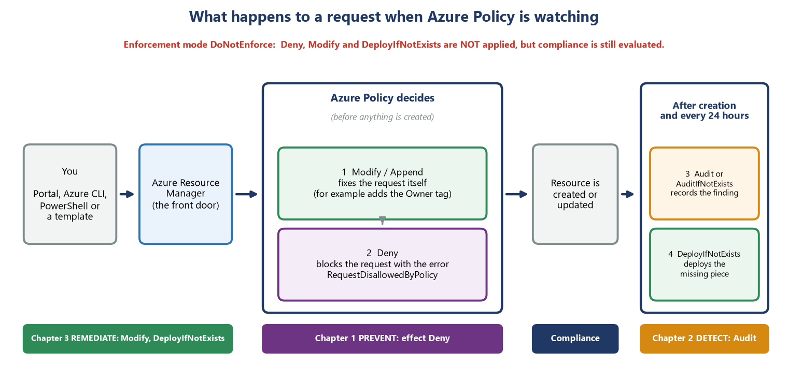

# Architecture: environment, policy scopes and the three chapters

This page is the one-page picture behind the [runbook](runbook/README.md). It shows what you start from, where each policy is assigned, and what each effect does.

## The environment you start from

The demo runs on the public [reference landing zone](https://github.com/stefpin/azure-landing-zone): a hub-and-spoke network with a production workload, a management workspace, an innovation zone and an isolated sandbox. The policies in this repository **add** to it; they do not rebuild it.

*Editable source: [`diagrams/azure-policy-demo-architecture.drawio`](../diagrams/azure-policy-demo-architecture.drawio) (draw.io, Azure icons).*

| Resource group | Role in the demo | What the policies do there |
| --- | --- | --- |
| `rg-alz-corp-prod` | The sample three-tier workload: Application Gateway with WAF, two web apps, PostgreSQL, Azure Managed Redis, Storage, Key Vault, a VM scale set (0 instances), four private endpoints | **Audit only** in Chapters 1 and 2. **Fix** only what you choose in Chapter 3: `Owner` tags and diagnostic settings |
| `rg-alz-policy-lab` | Empty and disposable | **Every blocking test.** Enforcement is on here and nowhere else (except for a few minutes at subscription level in Test 9) |
| `rg-alz-hub`, `rg-alz-mgmt` | Firewall, Bastion, private DNS; the central Log Analytics workspace | Not changed. The firewall address and the workspace are used as policy parameters |
| `rg-alz-innovation`, `rg-alz-sandbox` | Connected innovation zone; isolated sandbox | Not changed |

## Where each policy is assigned

*Editable source: [`diagrams/azure-policy-demo-scopes.drawio`](../diagrams/azure-policy-demo-scopes.drawio).*

Everything this repository creates starts with `alz-pd-` ("policy demo") so that it is easy to find and to remove.

| Assignment | Scope | Enforcement | What it is for |
| --- | --- | --- | --- |
| `alz-pd-c1-lab` | `rg-alz-policy-lab` | **Default** (switched on in step 2.3) | Chapter 1: blocks unsafe deployments in the lab |
| `alz-pd-c1-prod` | `rg-alz-corp-prod` | `DoNotEnforce` | Chapter 1 impact preview on the real application |
| `alz-pd-lab-nopeering` | `rg-alz-policy-lab` | **Default** | Test 8: no VNet peering (re-uses the landing zone's custom definition) |
| `alz-pd-rg-tags`, `alz-pd-rg-loc` | subscription | **Default** for a few minutes, then `DoNotEnforce` | Test 9: resource-group rules, matching `rg-alz-*` names only |
| `alz-pd-c2-prod`, `alz-pd-c2-lab` | `rg-alz-corp-prod`, `rg-alz-policy-lab` | `DoNotEnforce` (audit effects) | Chapter 2: find the gaps. Needs a managed identity with **no role** |
| `alz-pd-c3-prod` | `rg-alz-corp-prod` | `DoNotEnforce` | Chapter 3: changes happen only when *you* start a remediation task |
| `alz-pd-c3-lab` | `rg-alz-policy-lab` | **Default** | Chapter 3: new lab resources are fixed at creation |
| `alz-pd-c3-lab-vmbackup` | `rg-alz-policy-lab` | `DoNotEnforce` | Back up VMs tagged `Backup=daily` (built-in definition) |
| `alz-pd-sub-actlog` | subscription | `DoNotEnforce` | Optional: report whether the Activity Log is exported to the central workspace |

Part 5 switches every enforcing assignment back to `DoNotEnforce` (Level 1) and can remove all of it (Levels 2 to 4).

## What each effect does

*Modify (and Append) fix the request first; Deny blocks what is still wrong; Audit and AuditIfNotExists record findings afterwards and every 24 hours; DeployIfNotExists deploys the missing piece. `DoNotEnforce` switches the first, second and fourth off but still reports compliance.*

## The nine families and the 38 rules

| Family | Prevent (10 rules, mostly Deny) | Detect (21 rules, audit) | Remediate (7 rules, Modify and DeployIfNotExists) | Total |
| --- | --- | --- | --- | --- |
| F1 Locations | 1 | - | - | 1 |
| F2 Public exposure | 2 | 6 | - | 8 |
| F3 Data in transit | 3 | 2 | - | 5 |
| F4 Stored data and keys | 1 | 3 | - | 4 |
| F5 Monitoring | - | 5 | 5 | 10 |
| F6 Backup and recovery | - | 2 | - | 2 |
| F7 Compute baseline | - | 2 | - | 2 |
| F8 Network segmentation | 1 | 1 | - | 2 |
| F9 Ownership | 2 | - | 2 | 4 |
| **Total** | **10** | **21** | **7** | **38** |

Five **custom definitions** (no suitable built-in exists) support the demo: three are rules inside the initiatives - NSG rules that open SSH or RDP to the Internet, a default route that bypasses the firewall, and an Application Gateway listener without HTTPS - and two are assigned separately for the resource-group tests (required tags, allowed regions). The full list of the 38 rules with definition IDs is in [Appendix B](runbook/appendix-b-policy-catalogue.md); the JSON is in [`policies/`](../policies/).

## Managed identities and roles

Azure Policy has no hands of its own: a remediation uses a **managed identity** that belongs to the assignment, and that identity needs the roles named inside the policy definition.

| Policy | Effect | Roles the identity needs | Granted at |
| --- | --- | --- | --- |
| Inherit `Owner` / `CostCenter` tag | Modify | **Contributor** (the role named inside the built-in definition) | the resource group |
| Diagnostic settings (5 kinds) | DeployIfNotExists | **Log Analytics Contributor** | the resource group and the workspace `law-alz-central` |
| Back up VMs by tag | DeployIfNotExists | **Virtual Machine Contributor** and **Backup Contributor** | the lab resource group |
| Chapter 2 audit assignments, Activity Log report | audit / report only | **none** (Azure still requires an identity) | - |

Contributor is broad. In a real landing zone review it or use a custom role limited to tag writes. In this demo the roles are granted on one resource group each and removed in Part 5.
