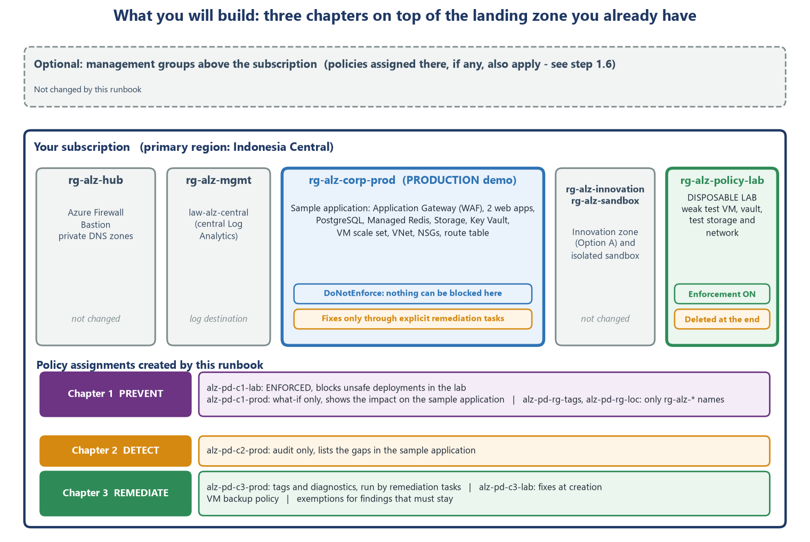

# Part 0 - Before you start

[Runbook index](README.md) &middot; Next: [Part 1 - Prepare the stage](01-prepare-the-stage.md)

## 0.1  What this runbook is - and is not

This runbook teaches you to **build and demonstrate technical guardrails with Azure Policy** on something real: an Azure landing zone and a three-tier sample application that already run in your own subscription. The public [reference landing zone](https://github.com/stefpin/azure-landing-zone) is the intended foundation. You will see policies **block** unsafe deployments, **find** weaknesses in the live application, and **fix** them - and you will see exactly what each control does to the application you already built.

The guardrails are grouped into **nine control families** and **three chapters**:

- **Chapter 1 - PREVENT.** Stop unsafe things before they are created (effect *Deny*). You prove it in a disposable lab, so nothing real can break.
- **Chapter 2 - DETECT.** Find the gaps in what already exists (effects *Audit* and *AuditIfNotExists*). You prove it on the real resources of the sample application, without changing them.
- **Chapter 3 - REMEDIATE and PROVE.** Fix what can be fixed automatically (effects *Modify* and *DeployIfNotExists*), record a formal exception for what cannot, and prove the result with evidence.

> [!CAUTION]
> **What this runbook is not**
>
> It is **not legal or regulatory advice**, and a green Azure Policy dashboard does **not** prove that your organisation complies with any regulation. Azure Policy checks the *configuration of Azure resources*. Identity processes, contracts, regulator approvals, incident handling, penetration testing and disaster-recovery exercises are outside Azure Policy (see section 0.9).
>
> It does **not** rebuild the landing zone. If a resource is missing, deploy the reference landing zone first (see section 0.3).



*Figure 1. The landing zone you start from, and the policy assignments this runbook adds.*

## 0.2  What you will demonstrate

The table shows what each chapter does for each control family. A dash means that chapter does not cover that family, because Azure Policy cannot do it or because it is not useful there.

| # | Control family (plain words) | Chapter 1 PREVENT blocks | Chapter 2 DETECT finds | Chapter 3 REMEDIATE fixes |
| --- | --- | --- | --- | --- |
| F1 | Approved deployment **locations** | Anything outside Indonesia Central and Southeast Asia; resource groups named `rg-alz-*` in the wrong region | - | -  (a policy cannot move a resource) |
| F2 | No unintended **public exposure** | Network interfaces with a public IP; NSG rules that open SSH or RDP to the Internet | Public network access on web apps, Storage, Key Vault, PostgreSQL, Redis; open VM management ports | Formal *Mitigated* exemption for the two web apps |
| F3 | Protect data **in transit** | Storage without HTTPS or with an old TLS version; web apps that allow HTTP | Application Gateway HTTP listener; web app TLS version | Formal *Waiver* for the demo HTTP listener |
| F4 | Protect **stored data and keys** | Key Vault without purge protection | Storage infrastructure encryption; encryption at host; Key Vault permission model | Engineering decisions (some changes cannot be made in place) |
| F5 | Central **monitoring** | - | Missing diagnostic settings on 5 resource types | Deploy diagnostic settings to `law-alz-central` |
| F6 | **Backup** and recovery protection | - | VM without backup; PostgreSQL without geo-redundant backup | Deploy VM backup by tag; *Waiver* for PostgreSQL geo-backup |
| F7 | Secure **compute** baseline | - | Trusted Launch; vulnerability assessment | Engineering decision (Trusted Launch needs the Enhanced backup policy first) |
| F8 | Network **segmentation** and controlled egress | Default route that bypasses the hub firewall; VNet peering in an isolated area | Subnets without an NSG | - |
| F9 | **Ownership** and accountability | Resources without `CostCenter` or `Owner` tags | (the Chapter 1 impact preview shows 26 resources without `Owner`) | Copy the `Owner` and `CostCenter` tags from the resource group |

A policy can appear in more than one chapter. That is intentional: the same rule can *block* a new resource, *report* an old one, and *repair* a third. Figure 2 shows where each effect acts.


*Figure 2. Where each Azure Policy effect acts on a request.*

## 0.3  The environment you start from

Everything below describes the **reference environment**: the hub-and-spoke landing zone and sample application of [`stefpin/azure-landing-zone`](https://github.com/stefpin/azure-landing-zone) (Option A, connected). Names follow that repository's `scripts/00-variables.ps1`. The settings and counts quoted in this runbook were measured in one dry run on an environment of this design. Your deployment can differ in small details; step 1.3 compares it with these tables.

### Resource groups

| Resource group | What it holds | What this runbook does with it |
| --- | --- | --- |
| `rg-alz-hub` | Hub network `vnet-alz-hub` (10.110.0.0/16), Azure Firewall Basic `afw-alz-hub` (private IP 10.110.0.4), Azure Bastion `bas-alz-hub`, private DNS zones | Nothing. Only the firewall address is used as a rule parameter. |
| `rg-alz-mgmt` | Log Analytics workspace `law-alz-central` (30-day retention) | Receives the diagnostic logs in Chapter 3. |
| `rg-alz-corp-prod` | **Sample application** - 26 resources in the dry run (table below) | **Audit** in Chapters 1 and 2. **Fix** only what you choose in Chapter 3: tags and diagnostic settings. |
| `rg-alz-innovation`, `rg-alz-sandbox` | Innovation landing zone (Option A: peered to the hub) with its Container Registry; isolated sandbox VNet (not peered) | Nothing. |
| `rg-alz-policy-lab` | Empty and disposable. Tagged `Disposable=yes`. | **All blocking demonstrations.** Test network, a weak VM, a backup vault and test storage are created here and deleted at the end. |

### The sample application - what is deployed and what state it is in

| Component | Name | Settings that matter for this runbook |
| --- | --- | --- |
| Application Gateway + WAF | `agw-alz-web`, `wafp-alz-web` | WAF_v2, OWASP 3.2 **Prevention**, **one HTTP listener (port 80)**, public IP `pip-alz-appgw`. State when the demo is idle: **Stopped** (to save cost). |
| Web apps (Linux) | `app-alz-frontend-a1b2`, `app-alz-backend-a1b2` | Running. HTTPS only, minimum TLS 1.2, FTPS only. Public network access **Enabled**, but access restrictions allow **only the gateway** (front end) or **only the front-end subnet** (back end) - a direct request returns **403**. |
| PostgreSQL Flexible Server | `psql-alz-a1b2` | Version 16. Public access **Disabled** (private endpoint). Backup 7 days, **geo-redundant backup Disabled**. State when the demo is idle: **Stopped**. |
| Azure Managed Redis | `redis-alz-a1b2` | Public access **Disabled**. TLS 1.2. |
| Storage account | `stalza1b2` | StorageV2, ZRS. HTTPS only, TLS 1.2, anonymous blob access off, public access **Disabled**. **Infrastructure encryption not enabled.** |
| Key Vault | `kv-alz-a1b2` | RBAC permission model, soft delete 90 days, public access **Disabled**. **Purge protection not enabled.** |
| Worker scale set | `vmss-alz-workers` | Flexible orchestration, Standard_D2as_v5, Ubuntu 22.04, **0 instances**. Security type Standard. **Encryption at host not enabled.** |
| Network | `vnet-alz-corp-prod` (10.120.0.0/16) | Five subnets. The subnets of the application, data and private-link tiers have an NSG, and every NSG contains a `Deny-RDP-SSH-From-Internet` rule. The gateway and web-app subnets (`snet-appgw`, `snet-appsvc`) have none, so Chapter 2 will most likely show one extra `SubnetHasNsg` finding for each of them (about 13 production findings instead of the 11 measured in the dry run). Route table `rt-alz-corp-prod` sends `0.0.0.0/0` to the hub firewall `10.110.0.4`. Four private endpoints in `snet-privatelink`. |
| Tags | all 26 resources | Every resource has `CostCenter=ALZ-Demo`. **None has an `Owner` tag.** The resource group itself must carry an `Owner` tag, because Chapter 3 copies it down to the resources (step 1.3 adds it if it is missing). |

### Policy objects that already exist (created by the reference landing zone)

The reference landing zone's governance script (`02-policy.ps1`) creates eight assignments, one initiative (`alz-baseline`) and one custom definition (`alz-deny-vnet-peering`). **All assignments use `DoNotEnforce`.** This runbook does not change, delete or rely on them.

| Assignment | Scope | What it does |
| --- | --- | --- |
| `alz-allowed-locations`, `alz-no-public-ip-nic`, `alz-require-costcenter-tag` | `rg-alz-corp-prod` | Allowed regions, no public IP on NICs, required `CostCenter` tag (built-in policies). |
| `alz-inno-allowed-locations`, `alz-inno-no-public-ip`, `alz-inno-require-tag` | `rg-alz-innovation` | The same three guardrails, inherited by the innovation zone as a Corp landing zone. |
| `alz-sandbox-no-peering` | `rg-alz-sandbox` | Custom policy `alz-deny-vnet-peering`: the sandbox must stay isolated. |
| `alz-baseline-lab` | `rg-alz-policy-lab` | Initiative `alz-baseline`: the four rules above in one package. |

### Policies you did not create (inherited from above)

If your subscription sits under a management group (or the **Tenant Root Group**) that already assigns policies, those policies apply to everything you create - and they can change the result of a test. Section 1.6 shows you how to find them and how to tell who blocked you. These are the kinds of inherited policy to watch for, and how this runbook stays robust:

| Kind of inherited policy | What it can do to this demo |
| --- | --- |
| A **Modify** policy that hardens new resources (for example storage settings) | A resource can be changed before any Deny rule is evaluated. So the Chapter 1 storage test uses **HTTPS-only**, not anonymous blob access, and data-plane commands use `--auth-mode login`. |
| A security benchmark initiative in **Audit** mode | Adds findings to the compliance screens that are **not yours**. Always filter by the name `alz-pd`. |
| A **Deny** policy on regions or resource types | The 'wrong region' test uses **East US**. If your tenant blocks that too, pick another unapproved region so that the denial clearly comes from this runbook's policy. The lab VM uses a small B-series size, which is normally allowed. |

## 0.4  What you need before you begin

| You need | Details | How to check |
| --- | --- | --- |
| An Azure account with enough rights | **Owner** on the subscription (or on a parent scope). Creating policy assignments and giving roles to the policy's managed identity needs Owner, or *Resource Policy Contributor* plus *User Access Administrator*. | Step 1.1 |
| The landing zone to test against | The [reference landing zone](https://github.com/stefpin/azure-landing-zone) deployed in your subscription, or an equivalent with the same names (section 0.3). Every resource group is named `rg-alz-...`. | Step 1.3 |
| A place to run commands | A Windows 10 or 11 laptop with the Windows Terminal app, **or** Azure Cloud Shell (PowerShell) in the Portal. The dry run used Cloud Shell; every path in this runbook uses forward slashes, which work in both. | Press the Windows key and type Terminal, or click the Cloud Shell icon in the top bar of the Portal. |
| PowerShell | PowerShell 7 (used in the dry run, in Azure Cloud Shell) **or** Windows PowerShell 5.1 (every script parses in it, but it has not been run end to end). | Run `$PSVersionTable.PSVersion`. |
| Azure CLI | Version **2.88 or newer** (this runbook was checked with **2.91.0**). | Run `az --version`. Install: `winget install Microsoft.AzureCLI`. |
| Microsoft Edge | Signed in to the Azure Portal with the same account. | Open https://portal.azure.com |
| Time | About **3 hours** the first time (including waiting). Plan the waits - policy evaluation is not instant. | See the timeline in section 0.6. |

> **Where to do this:** **PowerShell window.** Press the Windows key, type **Terminal**, press Enter, and open a **PowerShell** tab.

```powershell
$PSVersionTable.PSVersion          # 5.1.x or 7.x is fine
az --version                       # first line should say azure-cli 2.88.0 or higher
```

## 0.5  Safety rules - what this runbook touches and what it does not

If your subscription also hosts other workloads, these rules protect them - and they protect the running sample application.

| Rule | What it means in practice |
| --- | --- |
| **1. Everything new starts with `alz-pd-`** | Policy definitions, initiatives, assignments, exemptions and remediation tasks all carry the prefix. Lab resources are named `...-pd-...`. Appendix A lists every object and the command that removes it. |
| **2. Production is audit-only** | On `rg-alz-corp-prod` every assignment uses **`DoNotEnforce`**, so nothing can be blocked. The *only* changes to production are the two remediations you choose in Chapter 3 (the `Owner` tag and diagnostic settings). Both are reversible (Appendix A). |
| **3. Blocking happens only in the lab** | Enforcement is switched on only for `rg-alz-policy-lab`. Part 5 switches it off again and then deletes the lab. |
| **4. Subscription-level rules are narrow and short-lived** | Two policies must be assigned at subscription level to see resource-group creation. They match **only** resource groups whose names start with `rg-alz-`, so other resource groups are never affected. You switch them on for a few minutes and then off. |
| **5. Nothing above the subscription is touched** | No inherited policy is changed, excluded or overridden. No management group is created. |
| **6. Irreversible actions are labelled** | Anything that cannot be undone is marked **IRREVERSIBLE** in a red box and is optional. |
| **7. Nothing in other resource groups changes** | Resource groups that are not part of the landing zone (names that do not start with `rg-alz-`) are never touched. |

### Every change this runbook makes to existing resources

| Change | Where | Reversible? | Step |
| --- | --- | --- | --- |
| Add the `Owner` tag to the production and lab resource groups (only where it is missing) | `rg-alz-corp-prod`, `rg-alz-policy-lab` | Yes - Level 4 removes it | 1.3 |
| Start the Application Gateway and PostgreSQL (if they are stopped) | `rg-alz-corp-prod` | Yes - stop them again (Part 5) | 1.4 |
| Register the `Microsoft.RecoveryServices` resource provider | Subscription | Harmless; stays registered | 1.5 |
| Add the `Owner` tag to the 26 sample-application resources | `rg-alz-corp-prod` | Yes - remove the tag | 4.3 |
| Create a diagnostic setting `setByPolicy-LogAnalytics` on 4 resources | `rg-alz-corp-prod` | Yes - delete the setting | 4.4 |
| Create exemptions (record exceptions) | `rg-alz-corp-prod` | Yes - delete the exemption | 4.7 |
| Azure Backup creates the helper resource group `AzureBackupRG_indonesiacentral_1` the first time it protects the lab VM | Subscription (not an `rg-alz-` group) | Yes - deleted in step 5.3, but only if it is empty | 4.6 |

## 0.6  Cost and time

Prices are Azure retail list prices for Indonesia Central read in October 2026. Your agreement may differ.

| Item | When it exists | Approximate cost |
| --- | --- | --- |
| Lab VM `vm-pd-lab01` (Standard_B2ls_v2, Linux) | From step 1.8 to Part 5 | US$ 0.0475 per hour  (about US$ 0.20 for a 4-hour demo) |
| Public IP address (Standard, for one test) | A few minutes | About US$ 0.006 per hour |
| Recovery Services vault and the first VM backup | Chapter 3 to Part 5 | Cents for the demo; a few dollars per month if you forget to delete it |
| Log Analytics ingestion (diagnostic logs) | Chapter 3 | Megabytes only - effectively zero |
| Test Storage account, test Key Vault, test network | Chapter 1 to Part 5 | Cents |
| **Application Gateway WAF_v2, Azure Firewall Basic, Azure Bastion** | Already deployed | **These are the expensive meters.** The reference landing zone's `scripts/99-teardown.ps1 -Mode Pause` deletes them and can rebuild them. Keep them running only while you demonstrate. |

### Run-of-show: when to do what

Azure Policy needs time to evaluate. A new assignment starts working in about **5 minutes**; compliance results for existing resources appear in about **15 to 30 minutes**; a full scan runs every **24 hours**. Plan like this:

| When | What | Parts |
| --- | --- | --- |
| **T - 90 min** | Sign in, start the application, create the lab network and the weak VM, create the policy library (definitions and initiatives). | 1.1 - 1.10 |
| **T - 60 min** | Assign Chapter 1 (not enforced) to production and lab; assign Chapter 2 to production and lab. Start the compliance scans and wait. | 2.2, 2.6, 3.2 |
| **T - 20 min** | Run the pre-flight checklist. Switch lab enforcement on. Wait 10 minutes. | 1.11, 2.3 |
| **T** | The demonstration: Chapter 1 (45 min), Chapter 2 (30 min), Chapter 3 (45 min), wrap-up (15 min). | Parts 2 - 5 |
| **After** | Reset and clean up. | Part 5 |

## 0.7  Names and values used throughout

The variable names match the reference landing zone's `scripts/00-variables.ps1` wherever possible. In step 1.2 you paste one block of variables. It also creates the working folder `alz-policy-demo` in your user folder, where the JSON files are stored. Everything this runbook creates follows these naming patterns (the few names that Azure chooses by itself are listed in Appendix A):

| Prefix or pattern | Used for | Examples |
| --- | --- | --- |
| `alz-pd-<thing>` | Policy definitions | `alz-pd-nsg-no-internet-mgmt`, `alz-pd-route-default-via-fw` |
| `alz-pd-c1-...`, `-c2-`, `-c3-` | Initiatives and their assignments (c1 = Prevent, c2 = Detect, c3 = Remediate) | `alz-pd-c1-prevent`, `alz-pd-c1-lab`, `alz-pd-c2-prod` |
| `alz-pd-ex-...` | Exemptions | `alz-pd-ex-appsvc-frontend` |
| `alz-pd-rem-...` | Remediation tasks | `alz-pd-rem-owner-tag` |
| `...-pd-...` | Lab resources | `vnet-pd-lab`, `nsg-pd-lab`, `vm-pd-lab01`, `rsv-alz-pd-lab` |

> [!NOTE]
> **Where is the variable block?**
>
> It is in **step 1.2**. You do not need to type anything yet. Section 0.7 only explains the naming so that the commands later look familiar.

## 0.8  Azure Policy in ten minutes (for absolute beginners)

If you have never used Azure Policy, read this section slowly. Everything else builds on it.

### The idea

Think of Azure Policy as a **building inspector for your cloud**. Azure RBAC decides **who** may do something (who has a key to the building). Azure Policy decides **what** is allowed to exist (the building code). A person with full rights can still be stopped by Azure Policy if the thing they try to create breaks a rule.

### The six words you must know

| Word | Plain meaning | Example in this runbook |
| --- | --- | --- |
| **Policy definition** | One rule written in JSON: *if* a resource looks like this, *then* do this. | 'If a storage account does not require HTTPS, then Deny.' |
| **Initiative** (policy set) | A package of definitions you assign together. | `alz-pd-c1-prevent` holds the ten Chapter 1 rules. |
| **Assignment** | Switches a definition or initiative on for a **scope**. | `alz-pd-c1-lab` applies Chapter 1 to the lab. |
| **Scope** | Where an assignment applies: management group, subscription, resource group (or one resource). Rules flow **down** to everything inside. | `rg-alz-policy-lab` |
| **Effect** | What the rule does when it matches (table below). | Deny, Audit, Modify... |
| **Exemption** | A recorded, time-limited exception for one resource. | 'The web apps may keep public access because the gateway protects them.' |

### The effects you will use

| Effect | When it acts | What it does | Chapter |
| --- | --- | --- | --- |
| **Deny** | Before the resource is created or updated | Blocks the request with the error `RequestDisallowedByPolicy`. Existing resources are **not** deleted; they are reported as non-compliant. | 1 |
| **Audit** | After creation, and every 24 hours | Marks the resource non-compliant. Nothing is blocked or changed. | 2 |
| **AuditIfNotExists** | After creation, and every 24 hours | Marks the resource non-compliant if a **related** resource is missing (for example, a diagnostic setting). | 2 |
| **Modify** | On create and update; or later by a remediation task | Changes the resource (for example, adds a tag). Needs a managed identity. | 3 |
| **DeployIfNotExists** | After creation; or later by a remediation task | Deploys the missing related resource (for example, a diagnostic setting). Needs a managed identity. | 3 |
| **Disabled** | Never | Switches the rule off. | - |

### Enforcement mode - the safety switch

| Name in the CLI | Name in the Portal | What happens |
| --- | --- | --- |
| `Default` | **Default (enforcement)** | The effect is applied: Deny blocks, Modify changes, DeployIfNotExists deploys. |
| `DoNotEnforce` | **Do not enforce** | The effect is **not** applied, but compliance is **still evaluated and reported**. This is how you look at the impact safely. |

In the Portal the control is called **Policy enforcement** (a set of radio buttons in the assignment wizard, with a third choice, **Enroll**, that this runbook does not use). Older documents and screenshots call it *Enabled / Disabled*; the current Portal does not.

> [!WARNING]
> **Common trap**
>
> `DoNotEnforce` is **not** the same as the `Audit` effect. It does not change the rule; it changes whether the rule is *applied*. Also, a **remediation task can still run** on a `DoNotEnforce` assignment - that is exactly how Chapter 3 fixes production in a controlled way.

### Compliance states

- **Compliant** - the resource passes the rule.
- **Non-compliant** - the resource breaks the rule (or, for AuditIfNotExists, something is missing).
- **Exempt** - the resource is covered by an exemption.
- **Not started** - Azure Policy has not evaluated it yet. Wait and refresh.

### Three facts that surprise beginners

1. **Order of evaluation:** Azure Policy applies *Modify* first and *Deny* second. If one policy adds the missing tag and another denies a missing tag, the request **succeeds** (you will see this in section 4.5).
2. **Deny never deletes anything.** A Deny policy blocks *new* creates and updates. Resources that already exist stay where they are and are reported as non-compliant.
3. **Timing:** a new assignment applies in about 5 minutes; compliance data for existing resources appears in about 15 to 30 minutes; a full evaluation runs every 24 hours. You can force one with `az policy state trigger-scan`.

### Indexed or All?

Every definition has a **mode**. **Indexed** only looks at resource types that support tags and locations. **All** looks at everything, including resource groups and child resources (such as VNet peerings or NSG rules). **All custom policies in this runbook use mode All**, because several of them target child resources or resource groups, and a custom policy created with the default (Indexed) would silently do nothing.

## 0.9  How the nine families relate to regulatory expectations

The nine families cover the **outcomes** that financial-sector regulation and cloud-governance guidance commonly describe: control of where data lives, protection of data in transit and at rest, restricted access paths, logging and monitoring, backup and recovery, a secure configuration baseline, controlled network paths, and clear ownership. In Indonesia the regulators are the Financial Services Authority (OJK) for banks and non-bank financial institutions and Bank Indonesia (BI) for payment systems.

> [!NOTE]
> **How to use this mapping honestly**
>
> Regulation and guidance describe **outcomes** (confidentiality, integrity, availability, monitoring, recoverability, data location). They do **not** name Azure regions, Azure Policy definitions, a TLS version, private endpoints, tag names, customer-managed keys, log-retention days, recovery targets or VM sizes. All of those are **design choices that this demo proposes**.
>
> Treat the table as a source of **technical guardrail ideas**, not as a statement of what any regulation requires of you. Confirm the obligations that apply to your institution with your compliance and legal teams before you quote them. A fuller discussion is in [`docs/regulatory-themes.md`](../regulatory-themes.md).

| Family | Typical regulatory outcome (summary) | What Azure Policy can show | Stays outside Azure Policy |
| --- | --- | --- | --- |
| F1 Locations | Know, document and approve where the data centre and the disaster-recovery site are; offshore hosting may need approval | Resources exist only in approved regions | Regulator approval; the decision about which workloads are location-restricted |
| F2 Public exposure | Appropriate security controls for confidentiality, integrity, availability and authentication | No public IPs, no Internet-open management ports, public access settings | Penetration testing; identity design (MFA, PIM) |
| F3 Data in transit | Encryption of data in transit; secure data transmission | HTTPS-only and minimum TLS settings | Certificate management process |
| F4 Stored data and keys | Protection against unauthorised access, disclosure, alteration, loss or destruction | Encryption settings; Key Vault protection settings | Key management procedures; data classification |
| F5 Monitoring | A monitoring plan; regular monitoring of the provider's performance and continuity | Diagnostic logging is switched on and goes to one workspace | The people and process that read the logs; incident reporting |
| F6 Backup and recovery | A tested and adequate disaster-recovery plan; clear data-backup arrangements | Backup is configured; backup vault protection settings | The DR plan, the recovery targets and the restore **test** |
| F7 Compute baseline | System security standards | Trusted Launch, encryption at host, vulnerability assessment findings | Patching and hardening operations |
| F8 Network segmentation | Security of data access and transmission | Egress through the hub firewall; NSGs present; sandbox isolation | Firewall rule review |
| F9 Ownership | Clear accountability for every system and its data | Every resource has an owner and a cost centre | Governance and accountability processes |

> **What to say**
>
> Azure Policy gives your organisation **technical guardrails and compliance evidence for the Azure part** of its governance. It does not by itself make the organisation compliant. Contracts, approvals, identity governance, incident response and disaster-recovery testing still need their own owners.

---

[Runbook index](README.md) &middot; Next: [Part 1 - Prepare the stage](01-prepare-the-stage.md)
