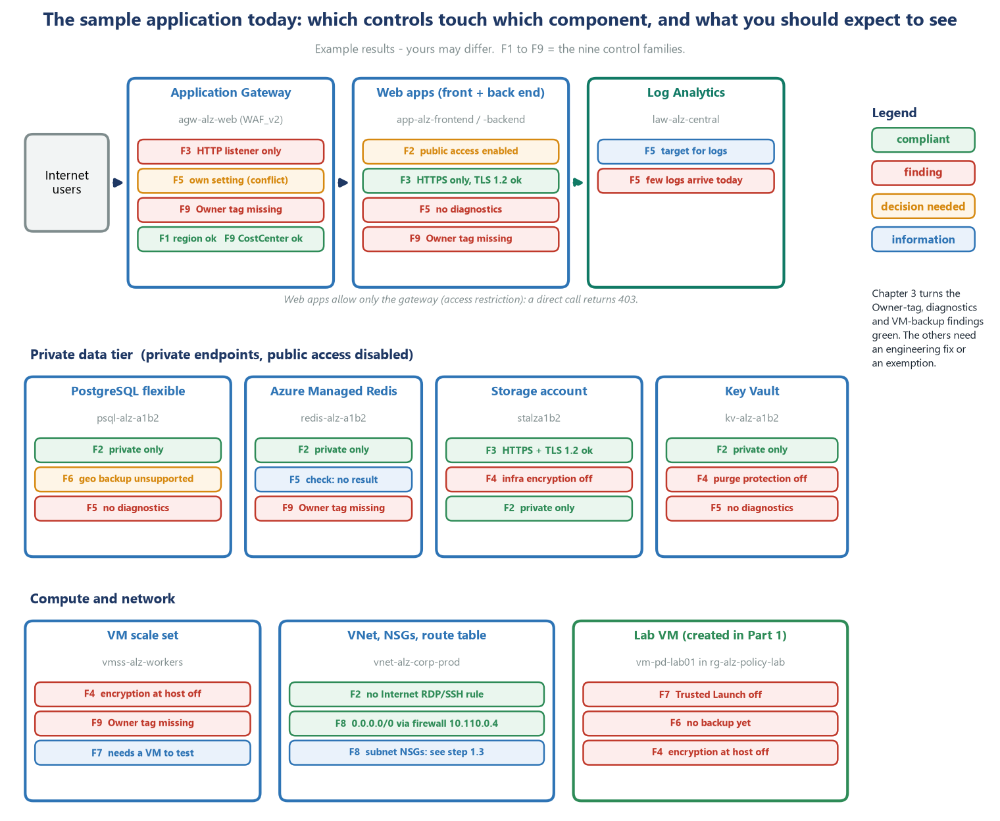

# Part 3 - Chapter 2: DETECT - find the gaps

[Runbook index](README.md) &middot; Previous: [Part 2 - Chapter 1: PREVENT - block unsafe deployments](02-chapter-1-prevent.md) &middot; Next: [Part 4 - Chapter 3: REMEDIATE and PROVE](04-chapter-3-remediate-and-prove.md)

Chapter 1 stopped *new* unsafe resources. Chapter 2 looks at what **already exists** - the real sample application - and tells you honestly where it falls short. Nothing is blocked, changed or restarted. You get a list of findings, each one traceable to a setting you can see in the Portal.

## 3.1  The idea

| Word | Meaning |
| --- | --- |
| **Audit** | If the resource breaks the rule, mark it **non-compliant**. Nothing else happens. |
| **AuditIfNotExists** | If a **related** resource is missing, mark the resource non-compliant. Example: 'this Key Vault has no diagnostic setting'. |
| **Finding** | One non-compliant result. A finding is information, not a failure. Some findings are fixed (Chapter 3), some are accepted with a written reason (exemption). |

> [!NOTE]
> **Audit is not the same as donotenforce**
>
> All Chapter 2 rules use the effects *Audit* and *AuditIfNotExists*, so they can never block or change anything - whatever the enforcement mode. In Chapter 1 you used `DoNotEnforce` to *switch a Deny rule off*. Both approaches show you the impact safely, but for different reasons.

Three things to remember about timing:

- A new assignment is picked up in about **5 minutes**. The first compliance results for existing resources appear after **10 to 30 minutes**.
- You can ask Azure to look now with `az policy state trigger-scan`. It still takes a few minutes.
- The two checks that depend on **Microsoft Defender for Cloud** (*VM management ports* and *vulnerability assessment*) can take **up to 24 hours** for a brand-new VM.

## 3.2  Assign Chapter 2 to production and to the lab

> **Where to do this:** **PowerShell window.** (This step uses the Portal only to look at the result, in 3.4.)

The Chapter 2 initiative needs one setting: the **resource ID of the central Log Analytics workspace** (it is used by the diagnostic-settings checks). Write it to a small file, then assign the initiative twice - once to production (the real findings) and once to the lab (the weak VM).

```powershell
@{ logAnalyticsWorkspaceId = @{ value = $LAW_ID } } | ConvertTo-Json -Depth 5 | Set-Content "$WORK/assign-law.json" -Encoding ascii

az policy assignment create --name "alz-pd-c2-prod" `
  --display-name "ALZ PD - Chapter 2 DETECT (PROD)" `
  --description "Audit-only checks on the production sample application. They cannot block or change anything." `
  --policy-set-definition "$SCOPE_SUB/providers/Microsoft.Authorization/policySetDefinitions/alz-pd-c2-detect" `
  --scope $SCOPE_CORP --params "@$WORK/assign-law.json" --enforcement-mode DoNotEnforce `
  --mi-system-assigned --location $LOC

az policy assignment create --name "alz-pd-c2-lab" `
  --display-name "ALZ PD - Chapter 2 DETECT (LAB)" `
  --description "Audit-only checks on the lab, including the deliberately weak VM." `
  --policy-set-definition "$SCOPE_SUB/providers/Microsoft.Authorization/policySetDefinitions/alz-pd-c2-detect" `
  --scope $SCOPE_LAB --params "@$WORK/assign-law.json" --enforcement-mode DoNotEnforce `
  --mi-system-assigned --location $LOC

az policy state trigger-scan -g $RG_CORP --no-wait
az policy state trigger-scan -g $RG_LAB --no-wait
```

> **What you should see**
>
> Two JSON blocks from the assignments, each with an `identity` section (`"type": "SystemAssigned"`). The scans start in the background and print nothing.

> [!NOTE]
> **Why does an audit-only assignment need an identity?**
>
> The initiative contains built-in definitions that *can* deploy resources (Chapter 3 uses the same definitions in `DeployIfNotExists` mode). Azure therefore insists on a managed identity for the assignment, even when you only audit. Without `--mi-system-assigned --location $LOC` the command fails with `ResourceIdentityRequired`. The identity gets **no role** in this chapter, so it cannot change anything.

### Look at the Chapter 2 assignment in the Azure Portal

> **Where to do this:** **Azure Portal** - **Policy** > **Authoring** > **Assignments**.

1. Policy > **Authoring** > **Assignments**; **Scope** pill = `rg-alz-corp-prod`; **Search** `ALZ PD`.
2. Click **ALZ PD - Chapter 2 DETECT (PROD)**. In **Essentials**: *Definition type : Initiative* and *Policy enforcement : DoNotEnforce*. Open the tab **Parameters** to see `logAnalyticsWorkspaceId` with the workspace ID.

## 3.3  Wait for the first results

> **Where to do this:** **PowerShell window.**

Run this every few minutes. It is ready when the table has a row for each of the families **F2, F3, F4, F5 and F6**, and the numbers stop changing between two runs about 5 minutes apart. (F8 and the two Defender checks can take longer - see 3.4.)

```powershell
Show-Scorecard -Targets "${RG_CORP}:alz-pd-c2-prod"
```

> **What you should see**
>
> A table with one row per family. When the evaluation is complete the production assignment alone has about **25 checks** across families F2 to F8.
>
> *Example output - do not type this:*
>
> ```text
> Family                 Checks Compliant NonCompliant Exempt
> ------                 ------ --------- ------------ ------
> F2-PublicExposure          .. ..                   2      0
> F3-DataInTransit           .. ..                   1      0
> F4-StoredDataKeys          .. ..                   2      0
> F5-Monitoring               5  0                   5      0
> F6-BackupRecovery           .. ..                  1      0
> F8-NetworkSegmentation     ..  ..                  0      0
> ```
>
> The numbers in the Checks and Compliant columns vary a little (they depend on how many sub-resources Azure evaluates; in the dry run F5 had 5 checks, because the Redis database gives no result). The **NonCompliant** column should match the table in section 3.5.

> [!WARNING]
> **Common trap**
>
> A table that is **empty** or has only a few rows means Azure has not finished. Wait another 10 minutes. Do not conclude that 'there are no findings'.

> [!NOTE]
> **Why you may see other findings in the portal**
>
> The Portal compliance page also lists results of **other** assignments that are not yours - for example an inherited security benchmark initiative or other audit assignments. In the Portal, always filter by the name **alz-pd**. The commands in this runbook already do that because they ask for one assignment by name.

## 3.4  Read the results

### In PowerShell - the list of findings

> **Where to do this:** **PowerShell window.**

```powershell
Show-Compliance -RG $RG_CORP -Assignment alz-pd-c2-prod
```

> **What you should see**
>
> About **11 rows**, sorted by family (**11** in the dry run). This is the findings list for the real application (see the table in section 3.5). Resource names come back in lowercase:
>
> *Example output - do not type this:*
>
> ```text
> Family            Check                           Resource                       Type
> ------            -----                           --------                       ----
> F2-PublicExposure AppServicePublicAccess          app-alz-backend-a1b2     Web/sites
> F2-PublicExposure AppServicePublicAccess          app-alz-frontend-a1b2    Web/sites
> F3-DataInTransit  AppGatewayHttpsListener         agw-alz-web            Network/applicationGateways
> F4-StoredDataKeys EncryptionAtHost                vmss-alz-workers        Compute/virtualMachineScaleSets
> F4-StoredDataKeys StorageInfrastructureEncryption stalza1b2           Storage/storageAccounts
> F5-Monitoring     DiagAppGateway                  agw-alz-web            Network/applicationGateways
> ...
> ```

### Read the findings in the Azure Portal

> **Where to do this:** **Azure Portal** - **Policy** > **Quick Access** > **Compliance**.

1. Policy > **Compliance**; **Scope** = `rg-alz-corp-prod`; **Search** `ALZ PD`; click **ALZ PD - Chapter 2 DETECT (PROD)**.
2. Tab **Policies**: the columns are **Name**, **Reference ID**, **Effect type**, **Version**, **Compliance state**, **Non-compliant resources** and **Total resources**. Sort by *Non-compliant resources*.
3. Click a row. On the tab **Resource Compliance** you see each resource, its **Compliance state** and a **Details** link under **Compliance reason**.
4. Back on the initiative page open the tab **Non-compliant resources** for the flat list of everything that needs attention.
5. To keep a copy for your records click **Export to CSV**.

> [!TIP]
> **Filter**
>
> Use the pill **Compliance state : All compliance states** to show only *Non-compliant* rows.

### The lab VM

> **Where to do this:** **PowerShell window.**

```powershell
Show-Compliance -RG $RG_LAB -Assignment alz-pd-c2-lab
```

> **What you should see**
>
> At least these three rows for `vm-pd-lab01`: **`VmTrustedLaunch`** (F7), **`EncryptionAtHost`** (F4) and **`VmBackupEnabled`** (F6). Two more may appear later: `VmVulnerabilityAssessment` and `VmManagementPortsClosed` (F2/F7) - they depend on Defender for Cloud and can take up to 24 hours (in the dry run both appeared within one hour). A `SubnetHasNsg` row for `snet-pd-lab` can appear as well, even though `nsg-pd-lab` is attached: the Defender result lags behind the change. That makes **6 rows** in the dry run.
>
> The lab storage account (`$ST_OK`) does **not** appear: it was created with infrastructure encryption and no public access, so it is compliant.

## 3.5  Walk through the findings, family by family

Figure 3 is the map. Every red or amber chip is a row you just listed. For each finding this section shows **what it means**, **how to prove with your own eyes that it is real**, and **what the decision will be in Chapter 3**.



*Figure 3. Sample application components and the findings you should expect.*

### Prove the findings are real

> **Where to do this:** **PowerShell window.** Run the block and compare each answer with the table below it.

```powershell
$KV_ID = az keyvault show -g $RG_CORP -n $KV --query id -o tsv

"F2  web app public access     : " + (az webapp show -g $RG_CORP -n $FE --query publicNetworkAccess -o tsv)
"F3  gateway listener protocol : " + (az network application-gateway http-listener list -g $RG_CORP --gateway-name $AGW --query "[0].protocol" -o tsv)
"F4  storage infra encryption  : " + (az storage account show -g $RG_CORP -n $ST --query encryption.requireInfrastructureEncryption -o tsv)
"F4  scale set encryption host : " + (az vmss show -g $RG_CORP -n vmss-alz-workers --query virtualMachineProfile.securityProfile.encryptionAtHost -o tsv)
"F4  key vault purge protection: " + (az keyvault show -g $RG_CORP -n $KV --query properties.enablePurgeProtection -o tsv)
"F5  key vault diagnostics     : " + (az monitor diagnostic-settings list --resource $KV_ID --query "[].name" -o tsv | Measure-Object).Count
"F6  PostgreSQL geo backup     : " + (az postgres flexible-server show -g $RG_CORP -n $PG --query backup.geoRedundantBackup -o tsv)
```

> **What you should see**
>
> *Example output - do not type this:*
>
> ```text
> F2  web app public access     : Enabled
> F3  gateway listener protocol : Http
> F4  storage infra encryption  :
> F4  scale set encryption host :
> F4  key vault purge protection:
> F5  key vault diagnostics     : 0
> F6  PostgreSQL geo backup     : Disabled
> ```
>
> An **empty** value means the setting is not set (`null`). Every line matches a finding. These are the *properties* behind the policy results, which is why you can trust them.

### The findings, what they mean, and the Chapter 3 decision

| Family | Finding (check) | Resources | What it means in plain words | Decision in Chapter 3 |
| --- | --- | --- | --- | --- |
| F2 | `AppServicePublicAccess` | 2 web apps | The web apps can be reached from the Internet at the platform level. In practice **access restrictions** allow only the gateway (front end) or the front-end subnet (back end); a direct call returns 403. | **Exemption - Mitigated.** The gateway and access restriction are the compensating control. |
| F3 | `AppGatewayHttpsListener` | 1 gateway | The demo gateway listens on HTTP port 80 only. It has no certificate or domain name in the demo. | **Exemption - Waiver** (time-limited). Production would use HTTPS with a certificate from Key Vault. |
| F4 | `StorageInfrastructureEncryption` | 1 storage account | Data is encrypted once (service-level). *Infrastructure* (double) encryption is off. It can only be chosen **when the account is created**. | **Engineering decision.** A new account and a data migration would be needed. Not fixed by policy. |
| F4 | `EncryptionAtHost` | 1 scale set | The temporary disks and caches of the worker VMs are not encrypted at the host. The scale set currently has 0 instances. | **Engineering decision.** Re-deploy the scale set with encryption at host (needs a one-time feature registration). |
| F4 | Key Vault purge protection (from Chapter 1) | 1 Key Vault | A deleted vault could be purged immediately. Purge protection is **irreversible** once enabled. | **Decision for the owner.** The runbook does not change the production vault. |
| F5 | `DiagKeyVault`, `DiagAppService` (x2), `DiagPostgres`, `DiagAppGateway` | 5 resources (in the dry run `DiagRedisEnterprise` returned no result for the Redis database, so it is neither reported nor fixed) | No logs are sent to `law-alz-central`. Nobody could investigate an incident. | **Fix automatically** for four of them - deploy the diagnostic settings (section 4.4). The gateway already has a setting of its own: see the trap in 4.4. |
| F6 | `PostgresGeoBackup` | 1 database | Backups are kept only in the same region. Geo-redundant backup is **not available in Indonesia Central** (the region has no paired region). | **Exemption - Waiver.** It is technically impossible today; zone-redundant options and the 7-day local backup remain. |
| F9 | Owner tag (from Chapter 1) | 26 resources | Nobody is recorded as the owner. | **Fix automatically** - copy the tag from the resource group (section 4.3). |

### The things that are already good

A good audit also says what is **right**. Note these compliant results - they are evidence that these settings are as designed:

| Check | Result |
| --- | --- |
| `StoragePublicAccess`, `KeyVaultPublicAccess`, `PostgresPublicAccess`, `ManagedRedisPublicAccess` | **Compliant.** All four data services have public network access disabled and use private endpoints. |
| `AppServiceMinTls` | **Compliant.** Both web apps require TLS 1.2 or newer. |
| `KeyVaultUsesRbac` | **Compliant.** The vault uses Azure RBAC instead of access policies. |
| `SubnetHasNsg` | **Compliant** when every subnet has an NSG (the result depends on Defender for Cloud assessments and can lag behind a change). |

> **What to say**
>
> The audit found about **eleven** gaps in the production application and **three to six** in the lab VM (on top of the two that Chapter 1 already showed: the Owner tag and the Key Vault purge protection). None of them stops the application from working, and we can say exactly why each one exists. Of the eleven in production we will fix four automatically (the missing logs), record four as accepted exceptions and hand two to engineering as decisions; the last one - the gateway's logs - is already covered by the gateway's own setting. The data services already have public network access disabled - the most important design goal of the landing zone is met.

## 3.6  Prove the application is untouched

> **Where to do this:** **PowerShell window.**

```powershell
Test-SampleApp
```

> **What you should see**
>
> **403** directly and backend health **Healthy** (and **200** through the gateway from a client the gateway accepts). Detecting changed nothing.

> [!IMPORTANT]
> **CHECKPOINT - do not continue until all of this is true**
>
> - `Show-Compliance` lists about 11 findings for production and at least 3 for the lab VM.
> - You can explain, for each family, one finding and the decision you will make.
> - `Test-SampleApp` shows **403** directly and backend health **Healthy** (and **200** through the gateway, if your client can reach it).

---

[Runbook index](README.md) &middot; Previous: [Part 2 - Chapter 1: PREVENT - block unsafe deployments](02-chapter-1-prevent.md) &middot; Next: [Part 4 - Chapter 3: REMEDIATE and PROVE](04-chapter-3-remediate-and-prove.md)
